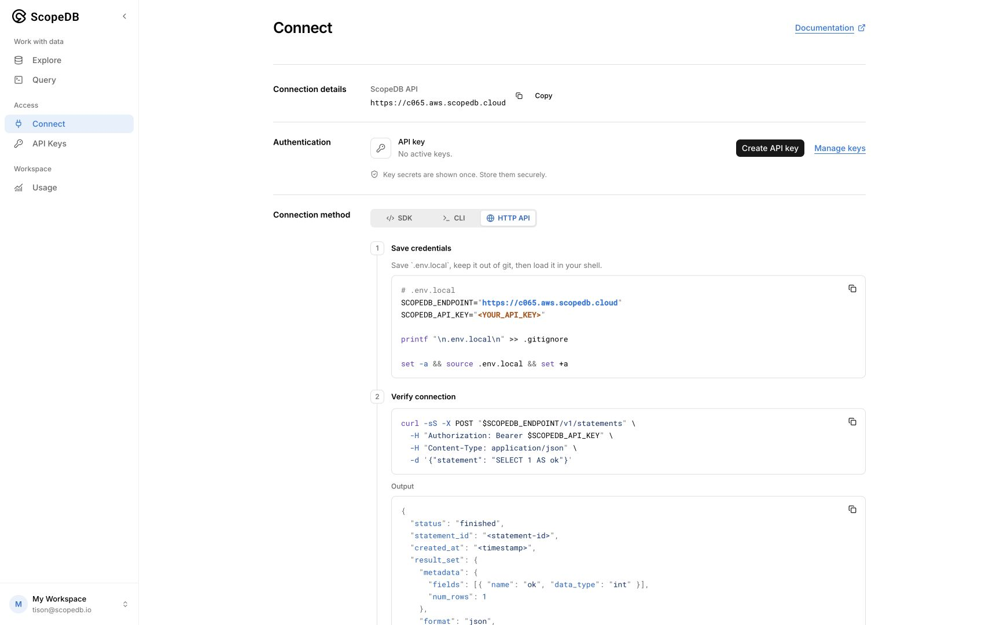
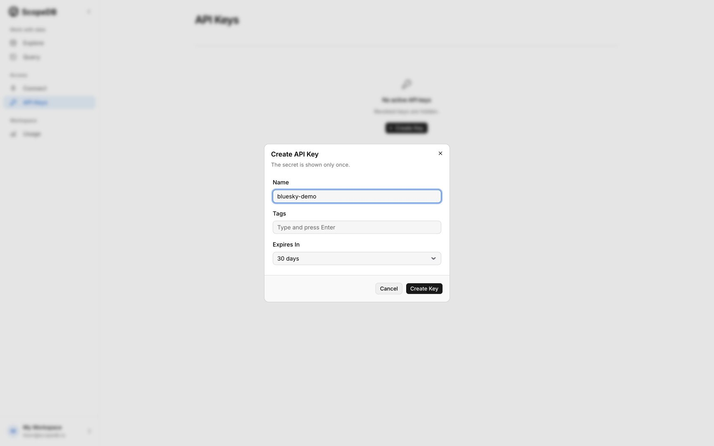
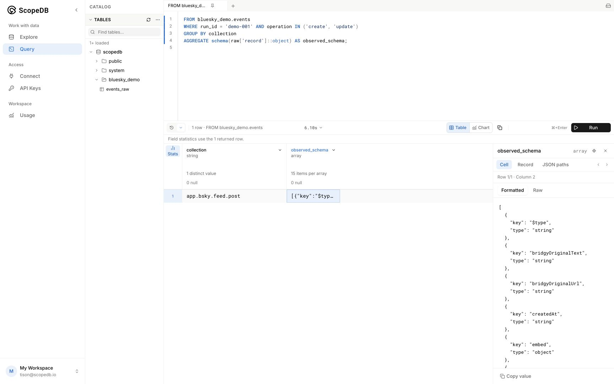
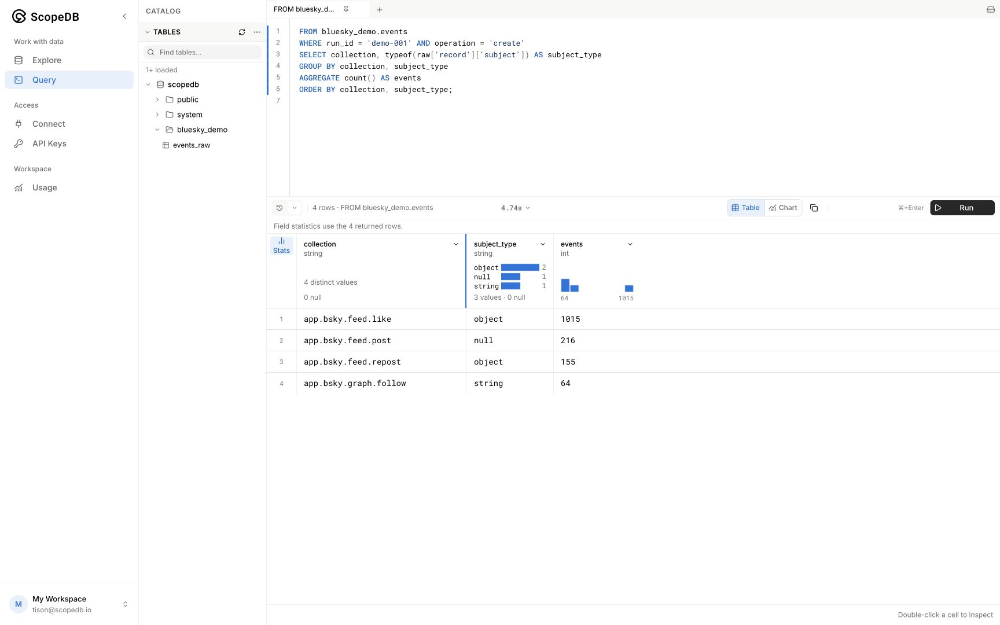
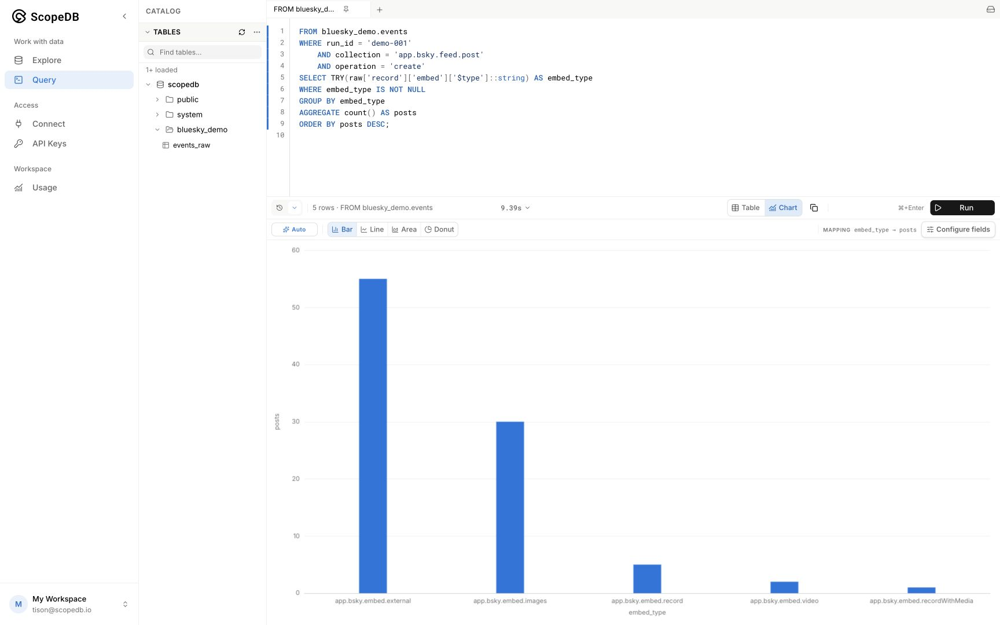

# Explore Bluesky events with ScopeDB

What fields arrive in a real event stream, and how do you query them when different events have different shapes?

In this walkthrough, you will capture a short sample of public Bluesky activity, load posts into ScopeDB, and then add likes, reposts, and follows to the same table. You will discover their fields, query nested values, and repeat an import without double-counting events. The event payload stays in an `object` column throughout.

Allow about 15–20 minutes after account setup. The collector runs locally; you will run the queries in ScopeDB Console.

## 1. Prepare your account and tools

You need:

- A ScopeDB Cloud account and a workspace. [Sign up](https://console.scopedb.cloud/?signup) if you do not have an account, or [sign in](https://console.scopedb.cloud/) with your existing account. Complete the email verification and workspace setup shown by Console before continuing.
- [Go 1.24 or later](https://go.dev/doc/install) and Git.
- A terminal running Bash or Zsh on macOS or Linux; Windows users can use WSL.
- Network access to ScopeDB Cloud and Bluesky's public Jetstream service. Reading the live stream does not require a Bluesky account or API key.

The default capture contains at most 5,000 events. You will import it once, then import another copy in the replay step. Retrying a load can also add repeated rows to the raw table. Your workspace's normal ingestion, storage, and query usage applies. Nothing continues running after the commands finish.

Clone the repository and open the scene:

```bash
git clone https://github.com/scopedb/demo-scene.git
cd demo-scene/bluesky-events
go version
```

If you already have the repository, start in its `bluesky-events` directory. Run all terminal commands below from this directory and keep the same terminal open.

## 2. Connect the collector to your workspace

In Console, check the workspace selector at the bottom left. Use this same workspace for the API key and every query below.

Open **Connect** in the left navigation. Copy the address labeled **ScopeDB API**. This is the address the collector needs; your value may differ from the screenshot.



Click **Create API key** (**Create new key** if your workspace already has keys). Enter a name such as `bluesky-demo`, choose an expiration, and click **Create Key**. Copy the secret when it appears; you can retrieve the full secret only at creation time. If you already have a usable key for this workspace, you can use it instead.



In your terminal, replace the endpoint placeholder, then paste your API key at the hidden input prompt:

```bash
export SCOPEDB_ENDPOINT='https://PASTE-YOUR-SCOPEDB-API-ADDRESS'
printf 'ScopeDB API key: '
read -rs SCOPEDB_API_KEY
printf '\n'
export SCOPEDB_API_KEY
```

The key is held in this terminal's environment. Do not paste it into the query editor or commit it to the repository.

## 3. Create the event table

Open **Query** in Console. Paste and run each block below separately using **Run** or **⌘+Enter** on macOS. Replace the editor contents for each block, and check that the result reports success before continuing.

Create a schema for this demo:

```sql
CREATE SCHEMA bluesky_demo;
```

Create a table with a few fixed columns and the complete event payload:

```sql
CREATE TABLE bluesky_demo.events_raw (
    run_id string,
    event_id string,
    event_time timestamp,
    ingested_at timestamp,
    collection string,
    operation string,
    raw object
);
```

Create a view that keeps one copy of each event per run:

```sql
CREATE VIEW bluesky_demo.events AS
FROM bluesky_demo.events_raw
DISTINCT ON run_id, event_id BY ingested_at DESC;
```

You will query `bluesky_demo.events` throughout the walkthrough. The underlying `events_raw` table retains every imported row, so the final step can show what happens during replay. These statements are also in [01-create.scopeql](queries/01-create.scopeql).

If you already created these objects in an earlier run of this tutorial, reuse them and skip this setup step. Use a new `run_id` when loading another capture, as shown in [Continue exploring](#9-continue-exploring). Keep this schema dedicated to Bluesky events.

## 4. Capture a short slice of public events

Create a directory outside the repository for captures you can revisit, then start the collector:

```bash
export DEMO_DATA_DIR="$HOME/scopedb-demo-data/bluesky-events"
mkdir -p "$DEMO_DATA_DIR"
go run . capture -out "$DEMO_DATA_DIR/events.ndjson"
```

The first run downloads the pinned Go dependency. After connecting, capture stops at 30 seconds, 5,000 events, or 50 MiB, whichever comes first. It subscribes to posts, likes, reposts, and follows and reports how many events it captured in each collection.

A successful run ends with output like this; your counts will differ:

```text
Saved 5000 events (3592829 bytes) to .../events.ndjson
  app.bsky.feed.post: 661
  app.bsky.feed.like: 3395
  app.bsky.feed.repost: 553
  app.bsky.graph.follow: 391
```

Keep this file for later exploration. It lets you load the same observed events in stages and replay them without depending on a later stream sample. Each line contains the source endpoint and one complete event payload. No public user content is bundled in this repository.

If any collection has no events, take a longer sample in a new file before proceeding:

```bash
go run . capture -duration 60s -limit 10000 \
  -out "$DEMO_DATA_DIR/events-longer.ndjson"
```

Use that filename in the remaining commands. The collector deliberately refuses to overwrite an existing capture.

## 5. Start with posts and discover their fields

Load only the post events from your capture:

```bash
go run . load -file "$DEMO_DATA_DIR/events.ndjson" -stage posts
```

The last `Loaded ... events for run demo-001 (posts)` line reports the acknowledged total. Return to **Query** and run:

```sql
FROM bluesky_demo.events
WHERE run_id = 'demo-001'
GROUP BY collection
AGGREGATE count() AS events
ORDER BY events DESC;
```

You should see one collection, `app.bsky.feed.post`, with the number of posts printed by the collector. This count includes create, update, and delete events.

Now discover the fields carried by the records:

```sql
FROM bluesky_demo.events
WHERE run_id = 'demo-001' AND operation IN ('create', 'update')
GROUP BY collection
AGGREGATE schema(raw['record']::object) AS observed_schema;
```

The result describes fields observed in this sample. Expect `text` and `createdAt`, often alongside `langs`, `reply`, `embed`, or `facets`. Double-click the `observed_schema` cell to open **Cell details** on the right. Field order and optional fields vary with the sample.



Delete events have no record body, so this query uses only creates and updates. `schema()` describes the object level you pass to it. To inspect a nested object, pass that object explicitly instead.

## 6. Add likes, reposts, and follows

In the same terminal, load the other three collections from the same file:

```bash
go run . load -file "$DEMO_DATA_DIR/events.ndjson" -stage social
```

Run the count and schema queries from step 5 again. You should now see four collections. You have added no columns and changed no ingestion mapping: the different records are all stored under `raw['record']`.

The `subject` field makes the difference especially clear. Run:

```sql
FROM bluesky_demo.events
WHERE run_id = 'demo-001' AND operation = 'create'
SELECT collection, typeof(raw['record']['subject']) AS subject_type
GROUP BY collection, subject_type
AGGREGATE count() AS events
ORDER BY collection, subject_type;
```

For standard Bluesky records, expect these shapes:

| Collection | `subject_type` | Meaning |
| --- | --- | --- |
| `app.bsky.feed.post` | `null` | Posts do not normally have a `subject` field. |
| `app.bsky.feed.like` | `object` | A reference containing the liked record's URI and CID. |
| `app.bsky.feed.repost` | `object` | A reference containing the reposted record's URI and CID. |
| `app.bsky.graph.follow` | `string` | The followed account's DID. |

A missing object field evaluates to `NULL`; `typeof` returns the text label `null` for that value. The object column preserves both the reference objects and the DID strings, so you can inspect their actual types at query time.



If a collection name is truncated, drag the right edge of its column header to widen it. The screenshot uses the same query and a wider `collection` column.

## 7. Ask questions about nested fields

Which kinds of embedded content appear in the posts you captured?

```sql
FROM bluesky_demo.events
WHERE run_id = 'demo-001'
    AND collection = 'app.bsky.feed.post'
    AND operation = 'create'
SELECT TRY(raw['record']['embed']['$type']::string) AS embed_type
WHERE embed_type IS NOT NULL
GROUP BY embed_type
AGGREGATE count() AS posts
ORDER BY posts DESC;
```

You may see `app.bsky.embed.images`, `app.bsky.embed.external`, or other embed types. `TRY(...)` lets the query continue when a value has an unexpected type. The `IS NOT NULL` filter keeps named embed types. To count posts without an embed as well, remove that filter and inspect the `NULL` row in **Table** view; it also includes values that cannot be cast to a string.

With the filter in place, click **Chart** in the results toolbar and select **Bar**. Console automatically maps `embed_type` to the categories and `posts` to the values. Check the mapping shown above the chart. These counts describe this captured slice of activity, not all of Bluesky.



Switch back to **Table**, replace the editor contents, and run the next query: how many captured posts are replies?

```sql
FROM bluesky_demo.events
WHERE run_id = 'demo-001'
    AND collection = 'app.bsky.feed.post'
    AND operation = 'create'
SELECT raw['record']['reply'] IS NOT NULL AS is_reply
GROUP BY is_reply
AGGREGATE count() AS posts
ORDER BY posts DESC;
```

The result groups posts into `true` and `false`. You queried nested content without first flattening every possible field into a column. All investigation queries are also available in [queries/](queries/).

## 8. Replay without double-counting

Run these two queries separately and note their results:

```sql
FROM bluesky_demo.events_raw
WHERE run_id = 'demo-001'
AGGREGATE count() AS stored_rows;
```

```sql
FROM bluesky_demo.events
WHERE run_id = 'demo-001'
AGGREGATE count() AS unique_events;
```

Now import the same capture again, including all four collections:

```bash
go run . load -file "$DEMO_DATA_DIR/events.ndjson" -stage all
```

Run both count queries again. `stored_rows` increases by the number of events in the capture and `unique_events` stays unchanged. If each stage succeeded on its first attempt, this first replay doubles `stored_rows`. Retrying an interrupted import may have already added repeated rows to the raw table. The view removes repeated deliveries; it does not delete rows from the raw table.

An event ID combines its source endpoint and sequence number. Replaying the same file with the same `run_id` preserves those IDs. A later update or delete is a separate event and remains in the view. This is an event history, not the current state of every Bluesky record.

The default run ID is `demo-001`. To keep another run separate, pass `-run-id demo-002` to every load command for that run and change the queries' `run_id` filter to match.

## 9. Continue exploring

Your table, view, and captured events remain available. Keep using **Query** to explore other fields, inspect an `embed` or `reply` object with `schema()`, or change the filters to answer another question.

To capture activity at another time, use a new filename and run ID. Reuse the table and view you already created:

```bash
go run . capture -out "$DEMO_DATA_DIR/events-demo-002.ndjson"
go run . load -file "$DEMO_DATA_DIR/events-demo-002.ndjson" \
  -stage all -run-id demo-002
```

Change the investigation queries to `run_id = 'demo-002'` to explore the new sample, or compare collection counts across your captures:

```sql
FROM bluesky_demo.events
GROUP BY run_id, collection
AGGREGATE count() AS events
ORDER BY run_id, events DESC;
```

This query is also in [08-compare-runs.scopeql](queries/08-compare-runs.scopeql). Use a distinct run ID for each new capture and keep the same run ID when replaying an existing file. If you return in a new terminal, set `DEMO_DATA_DIR` again and reconnect using step 2; your stored data is still available in Console.

## Troubleshooting

| Symptom | What to do |
| --- | --- |
| Jetstream cannot connect or no events arrive | Retry with `-source wss://jetstream.us-east.bsky.network` and a new output filename. Check outbound WebSocket access. |
| A capture stops with an error | Complete lines already written can still be loaded. For a fresh sample, use a new output filename. |
| `401` or `403` when loading | Recheck the API address, key, expiration, and workspace. The Console login and the collector's API key are separate credentials. |
| Table not found | Run all three setup statements in the workspace matching the API key. |
| `413` when loading | Retry with `-batch-size 20` or a smaller value. |
| `429`, a timeout, `EOF`, or a server error when loading | The command stops rather than silently retrying. Wait for the connection or service to recover, then replay the same file, stage, and run ID. Earlier batches may have succeeded; query the deduplicated view. |
| No rows for a query | Check the `run_id`, ensure the relevant load command finished, and compare with the collection counts printed during capture. |
| Table missing from the Query catalog | Click **Refresh catalog**. You can still run a query using its full `bluesky_demo.events` name. |

## Source and local checks

Last verified on October 10, 2026, with Go 1.27.1 on macOS (arm64) and ScopeDB Cloud. The walkthrough was tested with a live 5,000-event capture, staged imports, the investigation queries, and replay. Screenshots show a separate live sample; your fields and counts will differ.

The collector uses the public [Jetstream v2 JSON WebSocket](https://bsky.network/docs/jetstream/) with collection filters and `kinds=commit`. It preserves record fields in their original JSON types. `event_time` uses the source's `witnessedAt` timestamp when present, otherwise `time`; it does not use a post author's `createdAt` value. This bounded capture does not reconnect automatically or request the historical archive.

The public stream contains content supplied by its authors. Keep capture files out of source control and use aggregate results when sharing screenshots.

To run the collector's local checks:

```bash
go test -race ./...
go vet ./...
```
