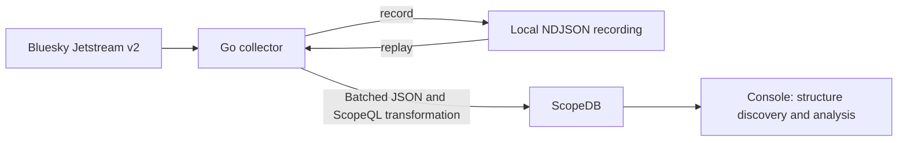

# Bluesky Events: Discover Structure as Data Arrives

Status: Design proposal. The collector, setup, and walkthrough have not been implemented. The source connectivity checks below have been performed; ingestion and queries against ScopeDB remain unverified.

## Demonstration goal

Start with live Bluesky posts, discover their structure in ScopeDB, and then add likes, reposts, and follows to the same table. The audience should see new event shapes become queryable while the table definition, ingestion transformation, and existing post queries continue to work.

The opening question is: **What is happening in this slice of Bluesky activity, and what can we learn without defining every payload field in advance?**

Bluesky defines its record types through Lexicons. This scene demonstrates expanding the set of structures observed by the database; it does not depend on an upstream protocol change happening during the presentation. A particularly useful example is `record.subject`: likes and reposts use an object reference, while follows use a DID string.

- Audience: developers evaluating flexible event ingestion and exploratory analytics.
- Target presentation length: 8–10 minutes.
- First implementation: one Go collector, ScopeQL files, and ScopeDB Console.
- Setup estimate: to be established by a fresh-checkout run before publishing the runnable demo.

## Source selection and evidence

| Source | Access and recovery | Decision |
| --- | --- | --- |
| [Bluesky Jetstream v2](https://bsky.network/docs/jetstream/) | JSON over WebSocket, unauthenticated live subscriptions, server-side collection filters, and bounded cursor-based recovery | Primary source: several event types, nested records, optional fields, arrays, and record deletions |
| [Wikimedia EventStreams](https://wikitech.wikimedia.org/wiki/Event_Platform/EventStreams_HTTP_Service) | JSON over SSE, reconnect through `Last-Event-ID`, and timestamp-based consumption within the available history | Alternative source if a different story is needed; implementing a second adapter is outside the first milestone |
| [GitHub public events](https://docs.github.com/en/rest/activity/events) | HTTP polling; documented event latency ranges from 30 seconds to 6 hours | Better suited to a replay-oriented scene than this live walkthrough |

Short, read-only samples on **2026-10-10** confirmed connectivity from the development environment:

| Endpoint | Observation |
| --- | --- |
| `jetstream.us-west.bsky.network` | 2,500 messages in approximately 17 seconds: 298 posts, 1,709 likes, 263 reposts, 226 follows, and 4 account or identity events |
| `jetstream.us-east.bsky.network` | 2,204 messages during an 18-second attempt; all four requested collections were observed |
| `stream.wikimedia.org/v2/stream/recentchange` | 300 messages in approximately 14 seconds, including edit, new, categorize, and log events |

These durations include connection setup and are connectivity observations, not throughput benchmarks or availability guarantees. The two Jetstream samples overlap in time and should not be combined into a larger independent sample.

The western sample included 66 delete operations, one update, six distinct post embed types, language arrays, rich-text facets, reply objects, and additional record fields. It also confirmed the object-versus-string difference in `subject`. Sampling retained structural counters rather than a reusable recording, so a new capture is required for the replay dataset.

The source definitions are available in the official [post](https://github.com/bluesky-social/atproto/blob/main/lexicons/app/bsky/feed/post.json), [like](https://github.com/bluesky-social/atproto/blob/main/lexicons/app/bsky/feed/like.json), [repost](https://github.com/bluesky-social/atproto/blob/main/lexicons/app/bsky/feed/repost.json), and [follow](https://github.com/bluesky-social/atproto/blob/main/lexicons/app/bsky/graph/follow.json) Lexicons.

## Walkthrough

| Step | Presenter action | Observable result |
| --- | --- | --- |
| 1. Receive posts, about 2 minutes | Create the demo objects, subscribe to `app.bsky.feed.post`, and inspect committed rows | Raw posts are available alongside stable event metadata |
| 2. Discover structure, about 2 minutes | Run `schema()` on the record, then inspect selected nested objects | Optional language arrays, reply relationships, embeds, and additional fields become visible |
| 3. Expand the subscription, about 2 minutes | Add likes, reposts, and follows | The same table and ingestion transformation accept the new shapes; the original post query still works |
| 4. Ask new questions, about 2 minutes | Compare `subject` types, count post embed types, and calculate the share of reply posts | Nested fields participate in filters and aggregations without being promoted to dedicated columns |
| 5. Verify repeatability, about 2 minutes | Replay an already-loaded recording and compare logical event counts, then clean up | Duplicate delivery does not inflate the analysis view; cleanup removes only this run's rows |

Use ScopeDB Console to show the input rows, query text, and results together. A dedicated dashboard can follow once the walkthrough is useful on its own.

The live path adds collections at a recorded phase boundary. Newly subscribed collections are covered from that transition onward; the scene must not imply that their earlier activity was also captured. The rehearsed path loads a recording in explicitly labeled stages selected by collection while preserving the original payloads and timestamps.

## Data flow and execution modes



The collector has three explicit modes:

- `live`: subscribe and write events to ScopeDB.
- `record`: capture a bounded source stream and a manifest into a local directory without requiring a ScopeDB connection.
- `replay`: read a recording through the same envelope extraction and ScopeDB write path used by `live`.

Use the v2 endpoint `/xrpc/network.bsky.jetstream.subscribeEvents` with the `xrpc.v1.json` WebSocket subprotocol. The observed wire format has a transport envelope containing `payload`; commit payloads expose `seq`, `time`, `witnessedAt`, `collection`, `operation`, and an optional `record`. Keep this wire contract separate from any SDK-specific serialized event shape.

Subscribe to the following collections, retaining account, identity, and sync events as separate event kinds when they arrive:

```text
app.bsky.feed.post
app.bsky.feed.like
app.bsky.feed.repost
app.bsky.graph.follow
```

The collector validates the stable envelope needed for ingestion and recovery, then preserves the complete payload as an object. New business fields must survive ingestion without additions to Go structs or per-collection mappings. Images and videos remain references inside the event; the collector does not download media.

Use a single source endpoint for each run. Save the endpoint, subscription conditions, and last acknowledged sequence in the checkpoint. Sequence gaps are expected with collection filtering and do not by themselves indicate data loss. Treat a change of source instance as a new run instead of assuming its sequence numbers identify the same events.

## Proposed ScopeDB model

Use a dedicated `bluesky_demo` schema. The following statements describe the intended model and have not been executed against ScopeDB.

```sql
CREATE SCHEMA bluesky_demo;

CREATE TABLE bluesky_demo.events_raw (
    run_id string,
    event_id string,
    event_time timestamp,
    ingested_at timestamp,
    kind string,
    collection string,
    operation string,
    raw object
);

CREATE VIEW bluesky_demo.events AS
    FROM bluesky_demo.events_raw
    DISTINCT ON run_id, event_id
    BY ingested_at DESC;
```

| Field | Meaning |
| --- | --- |
| `run_id` | Identifies one demonstration dataset and isolates its queries and cleanup |
| `event_id` | Source endpoint plus the source sequence; stable across reconnects and replay of the same recording |
| `event_time` | Parsed `witnessedAt`, falling back to the payload's `time` when absent |
| `ingested_at` | ScopeDB ingestion time, assigned by the ingest transformation |
| `kind` | Event kind from the payload's type discriminator |
| `collection`, `operation` | Commit metadata; null for event kinds without these fields |
| `raw` | The complete original v2 payload, including the dynamic `record` when present |

The record's client-declared `createdAt` remains in `raw`; it is not the recovery cursor. Preserve source timestamps during replay and select the dataset by `run_id`, so a saved recording remains useful later.

The physical table is an event log. The view removes repeat delivery of the same source event while retaining distinct updates and deletes of a record. Record URI alone would be the wrong deduplication key for this event-counting model.

This follows ScopeDB's [typed columns plus flexible payload](https://docs.scopedb.io/guides/model-flexible-events) model and the documented [DISTINCT ON](https://docs.scopedb.io/reference/commands/stmt-query#distinct-on) query operator.

## Core queries and expected observations

These are draft queries for the proposed view. Replace `demo-001` with the selected run ID when implementing the walkthrough.

### Discover the fields present in each record type

```sql
FROM bluesky_demo.events
WHERE run_id = 'demo-001'
  AND kind = 'commit'
  AND operation IN ('create', 'update')
GROUP BY collection
AGGREGATE schema(raw['record']::object) AS observed_schema;
```

`schema()` summarizes keys and types at the current object level. Inspect a nested object by applying it again to that object, such as `raw['record']['embed']::object`. Compare summaries as sets; array ordering in the summary is not part of the demonstration's contract.

### Compare the types at the same field path

```sql
FROM bluesky_demo.events
WHERE run_id = 'demo-001'
  AND kind = 'commit'
  AND operation = 'create'
SELECT
    collection,
    typeof(raw['record']['subject']) AS subject_type
GROUP BY collection, subject_type
AGGREGATE count() AS events
ORDER BY collection, subject_type;
```

For the selected record definitions, expect objects for likes and reposts, strings for follows, and a missing subject for posts. The presentation should show these observations before choosing a type-specific extraction or cast.

### Analyze a newly discovered nested dimension

```sql
FROM bluesky_demo.events
WHERE run_id = 'demo-001'
  AND kind = 'commit'
  AND collection = 'app.bsky.feed.post'
  AND operation = 'create'
SELECT TRY(raw['record']['embed']['$type']::string) AS embed_type
GROUP BY embed_type
AGGREGATE count() AS posts
ORDER BY posts DESC, embed_type;
```

Keep the null group visible for posts without an embed. A failed cast must be distinguishable from a missing field in diagnostic queries rather than silently becoming an undocumented category. The exact counts and embed types vary in live mode; a fixed recording supplies the expected replay results.

Reply share is a second useful query: count post-create events with a non-null `record.reply` and divide by all post-create events in the same run. Each metric describes the captured event window, not current network-wide post, like, or follow totals.

## Recording and repeatability

Proposed capture limits are **5 minutes, 20,000 messages, or 50 MiB of uncompressed NDJSON**, whichever is reached first. Make these configurable and report the stopping reason. Limit memory independently of the capture size with a bounded queue; choose batch row, byte, and flush-time limits during the first ingestion experiment.

Each recording manifest includes the source endpoint, protocol and collector versions, filters, capture interval, first and last sequence, message count, checksum, and observed coverage. Keep recordings, manifests, checkpoints, and logs in a selected temporary directory outside the repository.

Before using a recording for the staged walkthrough, verify that it contains:

- All four selected collections, including both object and string `subject` values.
- Language arrays, reply objects, and multiple embed types.
- Delete events without a record body.
- At least one non-commit event.

Report missing coverage and ask the presenter to capture another bounded interval. The core walkthrough must not require a rare event, such as a particular embed variant or an update, to occur live on cue. Small hand-authored fixtures can cover rare failure and boundary cases in automated checks; keep those distinct from the real demonstration recording.

Replaying the same recording with the same `run_id` should preserve the analysis view's event counts. Replaying into a fresh run should reproduce the same normalized query results. Staged replay preserves source event IDs and timestamps even though collections are loaded in presentation order.

The source's live recovery window is finite. [Jetstream archive replay](https://bsky.network/docs/jetstream-replay/) adds authenticated HTTP requests and usage limits; it is outside the first milestone. If recovery falls outside the live window, stop with an explicit recovery error and let the presenter start a new capture or use a local recording. Local replay removes the Bluesky availability dependency but still requires ScopeDB.

## Failure handling and data semantics

| Condition | Required behavior |
| --- | --- |
| Disconnect or duplicate delivery | Resume the same source, retain stable event IDs, and advance the checkpoint only after the write is confirmed |
| Ambiguous ScopeDB write outcome | Stop checkpoint advancement, reconcile the affected event IDs, and resolve the batch before retrying; do not interpret a timeout as proof of failure |
| Write backlog | Bound memory, expose backlog and error counters, and stop explicitly if the configured recovery budget is exhausted |
| Missing fields or different value types | Preserve the payload and query the observed type before applying a type-specific operation |
| Delete event without `record` | Store the operation; exclude it from queries that inspect record bodies |
| Account, identity, or sync event | Preserve it with its kind and null commit-only columns; do not treat it as a malformed post |
| Duplicate source events | Deduplicate by source event identity, while preserving distinct revisions of the same record |
| Incomplete capture window | Label results as observed events; display match coverage if a later extension joins interactions to posts |

ScopeDB's [HTTP API retry guidance](https://docs.scopedb.io/developer/http-api#errors-and-retries) requires reconciliation of ambiguous writes. The view makes repeated events count once, but does not establish exactly-once delivery or prove that every source event was captured.

This is a short-lived event-analysis dataset, not a replica of current social state. A future continuously hosted application would also need to apply record and account deletions to retained content and account for resynchronization. Raw user content stays out of Git; cleanup removes the local recording and the run's stored rows.

## Implementation milestones and acceptance

### Milestone 1: a complete Console walkthrough

Implement the collector modes, example configuration, setup and query files, recording manifest, checks, and cleanup instructions. Pin dependencies and record the tested ScopeDB deployment or version after the first successful end-to-end run.

Suggested scene layout:

```text
bluesky-events/
  README.md
  .env.example
  go.mod
  go.sum
  main.go
  main_test.go
  queries/
    setup.scopeql
    discover.scopeql
    analyze.scopeql
    cleanup.scopeql
  testdata/
```

Acceptance criteria:

1. Expanding from posts to all four collections requires no table change or collection-specific ingestion mapping; the original post query remains valid.
2. Nested objects, arrays, optional fields, and mixed `subject` types survive ingestion and produce the expected structural observations.
3. Missing record bodies and non-commit events do not interrupt ingestion or corrupt record-level aggregates.
4. A fixed recording reproduces expected results in a fresh run; loading it twice into one run leaves the logical event counts unchanged.
5. A controlled disconnect and an ambiguous write exercise checkpoint behavior without silently claiming complete or exactly-once capture.
6. A fresh-checkout walkthrough documents prerequisites, setup time, data limits, expected results, and measured write-to-query visibility. Live-source freshness and ScopeDB query latency are reported separately.
7. Cleanup stops the collector, deletes only the selected run's database rows and local files, and allows a new run to complete. Removing shared demo views, tables, or the schema is a separate explicit teardown step.

The only database credentials needed for this milestone are a ScopeDB endpoint and an API key authorized for the dedicated demo objects. Use local environment variables or an ignored `.env`; the example file contains placeholders. ScopeDB usage is subject to the selected deployment's limits and billing. No Jetstream archive credentials or additional hosted services are required for the proposed live-and-local-replay path.

### Milestone 2: presentation and deeper exploration

After the core walkthrough is verified, add a recording of the presentation and consider a field-summary comparison view, post/interaction joins with visible match coverage, or an index experiment on a useful nested path. ScopeDB supports [object and expression indexes](https://docs.scopedb.io/guides/add-indexes); any performance comparison needs a controlled dataset, documented cache and index state, and measured results.

## Review decisions

- Is the transition from posts to several record types a clear demonstration of ScopeDB's flexible data model?
- Are structure discovery, embed distribution, and reply share useful enough to carry the first presentation?
- Does Console plus a collector provide the right first delivery, with a dedicated visual interface deferred until the story is validated?
- Are the proposed bounded capture and local replay sufficient for the intended presentation environment?
