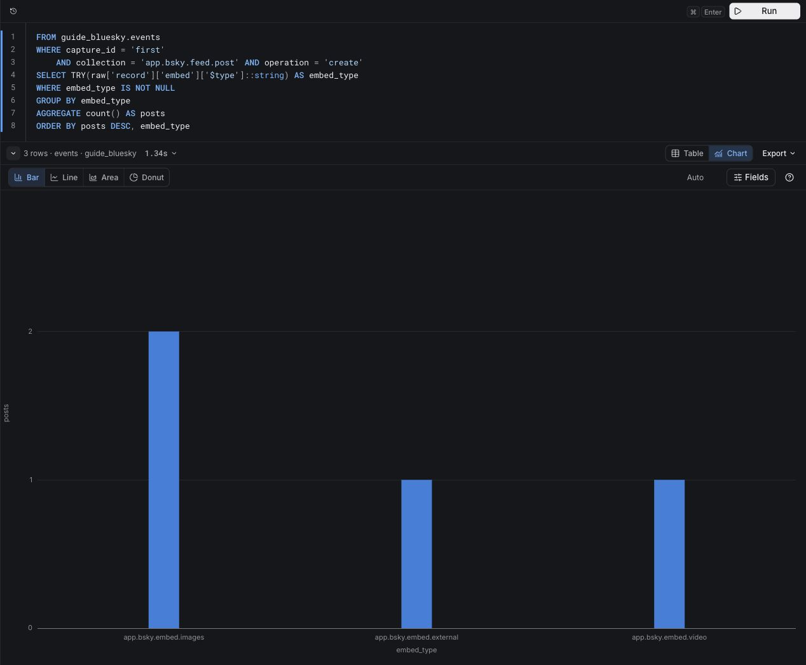
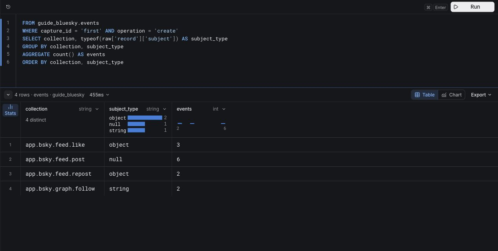

# Build a Bluesky activity briefing

Are people creating new posts, replying, or reacting to existing content? Start with 16 constructed events, check a useful briefing, then run the same investigation on saved live observations. The sample produces six new posts, including two replies, and five like or repost creations; three of those interactions target posts created inside the sample.

This scene is the runnable checkout of the [public tutorial](https://www.scopedb.io/docs/guides/analyze-bluesky-activity). The public tutorial explains each query and interpretation; this README gets your local files running and shows the main results. You need access to this private repository to clone it, but the public tutorial distributes the complete program independently. During draft review, use the tutorial preview linked from [website PR #124](https://github.com/scopedb/scopedb-site/pull/124).

## Before you start

You need a ScopeDB Cloud workspace, Go 1.24 or later, Git, and Bash or Zsh on macOS, Linux, or WSL. Allow about 15 minutes after account verification and workspace setup for the sample, then another 5–10 minutes for live capture and comparison. Appends, storage, and queries consume your workspace's normal allowance. The program exits after each command; it leaves no background collector.

The committed sample contains fictional accounts, content, and references. It is neither public user data nor an AT Protocol validation fixture. All expected results and screenshots below use that sample. Live captures vary and remain outside the checkout.

## 1. Open the scene and connect

```bash
git clone --branch docs/bluesky-events-proposal https://github.com/scopedb/demo-scene.git
cd demo-scene/bluesky-events
go version
```

These commands select the current draft branch. If you already have the checkout, switch to `docs/bluesky-events-proposal` and open its `bluesky-events` directory.

In [Console](https://console.scopedb.cloud), select a test workspace, open **Connect**, copy **ScopeDB API**, and create or reuse an API key for that workspace. The [connection guide](https://www.scopedb.io/docs/guides/connect-to-scopedb) covers workspace and key setup. Keep the same workspace selected for all queries.

```bash
export SCOPEDB_ENDPOINT='https://YOUR-SCOPEDB-API-ADDRESS'
printf 'ScopeDB API key: '
read -rs SCOPEDB_API_KEY
printf '\n'
export SCOPEDB_API_KEY
```

Keep this terminal open. Do not put the key in the query editor, screenshots, or source control.

## 2. Append the sample

In Console **Query**, run [01-create-schema.scopeql](queries/01-create-schema.scopeql), [02-create-table.scopeql](queries/02-create-table.scopeql), and [03-create-view.scopeql](queries/03-create-view.scopeql) separately. They create `guide_bluesky.events_raw` and `guide_bluesky.events` in the default `scopedb` database. Reuse these objects if they already exist; all remaining queries use the view.

The table has typed columns for capture ID, event ID, observation time, import time, collection, and operation, plus an `object` column holding the complete original payload. The view keeps one delivery per `(capture_id, event_id)`. It does not erase raw rows.

```bash
go run . load -file sample.ndjson -capture-id first
```

Expect `Loaded 16 events for capture first (all)`. The loader sends buffered NDJSON to the table's Append endpoint and requires a committed response with the expected row count. It performs the row mapping locally and preserves nested fields and large integer values in `raw`.

Use an unused capture ID instead of `first` if you want this visit kept separate, and update the query filters to match. This scene now uses the same `guide_bluesky` schema and `-capture-id` flag as the public tutorial. Data from an older `bluesky_demo`/`-run-id` walkthrough remains untouched; use the setup above for this version.

## 3. Produce the briefing

Run [04-activity-mix.scopeql](queries/04-activity-mix.scopeql):

```scopeql
FROM guide_bluesky.events
WHERE capture_id = 'first' AND operation = 'create'
GROUP BY collection
AGGREGATE count() AS creates
ORDER BY creates DESC, collection
```

The sample has six new posts, three likes, two reposts, and two follows. Two deletes and one update remain in the history but do not count as creation activity.

Run [05-replies-and-formats.scopeql](queries/05-replies-and-formats.scopeql) to separate replies from original posts and examine their outer embed types. Two of six posts are replies. Across both reply groups there are two image embeds, one external link, one video, and two missing embeds. Replies can contain images; adding reply counts to format counts would double-count posts.

Run [06-format-chart.scopeql](queries/06-format-chart.scopeql), then choose **Chart → Bar**. Check that `embed_type` supplies the categories and `posts` the values. This chart excludes missing or unconvertible embed types; inspect those rows before describing them as text only.

[](assets/post-formats.png)

Run [07-interaction-targets.scopeql](queries/07-interaction-targets.scopeql). It joins like and repost references to post creations observed in the same capture:

| Activity | Interactions | Targets observed | Targets not observed |
| -------- | ------------ | ---------------- | -------------------- |
| Likes    | 3            | 2                | 1                    |
| Reposts  | 2            | 1                | 1                    |

Your briefing can now say: **We observed six new posts, including two replies, and five like or repost creations. Three interactions targeted posts whose creation we captured. Images were the most common named embed.**

This does not show which content performs best. A like can target an older post, several people can like the same post, and this dataset has no impression denominator. An unmatched target may predate the window or be missing from it; it is not necessarily invalid. The next action is to inspect the reply threads and unmatched targets before selecting content examples.

## 4. Follow the result back to its evidence

The remaining investigation files explain the stored events:

| Query | What to inspect |
| ----- | --------------- |
| [08-observation-window](queries/08-observation-window.scopeql) | Actual UTC coverage and creates, updates, and deletes per collection. |
| [09-raw-events](queries/09-raw-events.scopeql) | Double-click `raw` in Console to inspect original nested values. |
| [10-discover-fields](queries/10-discover-fields.scopeql) | Fields observed on post creates/updates; deletes have no record body. |
| [11-subject-types](queries/11-subject-types.scopeql) | Likes/reposts have object references; follows have a DID string; posts have no subject. |

[](assets/subject-types.png)

`schema()` describes only the queried rows and object level. Use `schema(raw['record']['embed']::object)` to inspect embeds more deeply. A missing field evaluates to `NULL`; a follow's string subject is a different meaning, not a malformed like.

The sample-first path loads everything at once. To demonstrate schema flexibility in stages, use another capture ID and run `load -file sample.ndjson -stage posts -capture-id shapes`, then `load -file sample.ndjson -stage social -capture-id shapes`. The first stage acknowledges eight mutations; the second acknowledges eight more without altering the table. Change the evidence queries to `capture_id = 'shapes'`.

## 5. Continue with real observations

```bash
export DEMO_DATA_DIR="$HOME/scopedb-demo-data/bluesky-events"
mkdir -p "$DEMO_DATA_DIR"
go run . capture -out "$DEMO_DATA_DIR/live-first.ndjson"
go run . load -file "$DEMO_DATA_DIR/live-first.ndjson" -capture-id live-first
```

The collector uses [Bluesky's public Jetstream v2](https://bsky.network/docs/jetstream/) with four collection filters and no Bluesky key. It stops at 30 seconds, 5,000 events, or 50 MiB and prints the stop reason, source observation boundaries, and collection counts. Each new capture starts at the live tip; it does not reconnect or backfill. Existing filenames are never overwritten. A short live window may omit categories entirely.

Change the briefing queries from `first` to `live-first` and report actual results with their UTC boundaries. Keep live user content local and share aggregate findings. The constructed sample is only a query check; do not compare it to real traffic as a baseline.

Capture another live window when you want to compare activity:

```bash
go run . capture -out "$DEMO_DATA_DIR/live-second.ndjson"
go run . load -file "$DEMO_DATA_DIR/live-second.ndjson" -capture-id live-second
```

Run [14-compare-windows.scopeql](queries/14-compare-windows.scopeql) and [15-reply-share.scopeql](queries/15-reply-share.scopeql). They include only `live-first` and `live-second`. A higher reply share is a reason to inspect ongoing conversations before calling the activity a burst of new topics. Captures may hit different limits and last different durations, so larger counts alone do not establish a higher activity rate.

Keep the table, view, and files for continued exploration. Queries filter by saved capture IDs instead of the last 15 minutes, so they remain usable when you return later. With [your own agent](https://www.scopedb.io/agent), reuse this same tutorial and give it the workspace, capture IDs, business question, and a read-only scope. Save the tested queries, observation boundaries, definitions, and next action in your project notes; separately authorize any new writes or changes.

## 6. Check replay and recover an interrupted append

Run [12-stored-rows.scopeql](queries/12-stored-rows.scopeql) and [13-unique-events.scopeql](queries/13-unique-events.scopeql), then replay the sample:

```bash
go run . load -file sample.ndjson -capture-id first
```

Both counts start at 16 after a successful first import. Replay increases raw storage to 32 rows while the view stays at 16 unique events. The briefing stays unchanged. This is deduplication at query time, not exactly-once storage.

The loader stops on every unconfirmed response and never silently retries. `rejected` means that batch committed no rows; `unknown`, EOF, timeout, or missing acknowledgement may follow a committed write. Correct the cause, then replay the same file with the same capture ID. Earlier batches may already have succeeded. Check the view and raw counts separately; raw counts need not double after recovery.

## Data contract and troubleshooting

- `capture_id` labels one saved observation; use a new ID for a different capture and keep it unchanged during replay.
- `event_id` combines the source instance and its `seq`, identifying a mutation. A post's record URI identifies the entity being changed. Updates and deletes remain separate events.
- `event_time` prefers source `witnessedAt`, falling back to `time` on older servers. Operator imports may override `time`. Neither field is the author's `record.createdAt`.
- `ingested_at` is the loader's UTC clock while preparing a row, not a server commit timestamp or a measured end-to-end latency.
- Overlapping captures and different source instances are not globally deduplicated. Deletes do not erase earlier create payloads; unseen updates and account/identity changes are not reconstructed. This is an activity history, not a maintained public mirror.

| Symptom | Next step |
| ------- | --------- |
| No stream connection or events | Check outbound WebSocket access; use the sample or retry `-source wss://jetstream.us-east.bsky.network` with a new filename. |
| Capture interrupted | Complete lines remain available; a new capture starts at the live tip. |
| `401` / `403` | Recheck API address, workspace, key, and expiration. Console login does not authenticate the collector. |
| Table missing | Run the three setup files in the key's workspace; refresh the Query catalog if needed. |
| `413` | Retry the same file and capture ID with `-batch-size 20` or smaller. |
| Rejected or ambiguous append | Correct the error, then replay explicitly as above. Preserve request IDs for support. |
| Unexpected or empty results | Check capture ID, completed append, operation filter, and collection counts. |

## Implementation and checks

The program, tests, module files, and sample are vendored byte-for-byte from `scopedb-site/public/examples/bluesky-events`, identified by [upstream-revision.txt](upstream-revision.txt). Edit that public source first, then run `./scripts/sync-bluesky.sh /path/to/scopedb-site` from the demo-scene root. This keeps one collector implementation while both repositories remain runnable on their own. Review the query files and walkthrough together when the public tutorial changes.

```bash
go test -race ./...
go vet ./...
```

These tests need no service credentials. They cover raw-field and large-integer preservation, bounded capture, advisory frames, staged imports, mutation identity, Append acknowledgements, and explicit recovery after an ambiguous write. Integration checks must also run the saved queries against a real ScopeDB engine; local checks do not establish Cloud signup or API-key provisioning behavior.

Last checked on October 22, 2026, with Go 1.27.1 on macOS arm64 and the published ScopeDB v0.5.32 container in an isolated local stack. Sample results, all 15 saved statements, two fresh 5,000-event captures, staged loads, replay, and recovery after a committed batch with a lost response passed. The screenshots show the same constructed sample previously checked in Console. Fresh Cloud account creation and API-key appends were not repeated in this run.
